  

# Hein Sitt Tun

**Associate DevOps Engineer** · Cloud & Automation · Infrastructure as Code

Building reliable systems with Kubernetes, Terraform, and modern observability stacks.  
Focused on automation, monitoring, and clean infrastructure design.

📍 Yangon, Myanmar · 💼 [BIM ATS](https://www.bimats.com/) · 🌐 [Portfolio](https://heinsitt.vercel.app/)

---

### Currently

- Deepening expertise in **Kubernetes** and **Terraform**
- Building internal monitoring & automation solutions at BIM ATS
- Exploring AI-assisted development workflows (Claude, Antigravity, Cursor)

---

### Tech Stack

**Languages**  

**DevOps · Cloud · Observability**  

**AI & Tools**  

---

### Featured Projects

| Project | Stack | Description |
|---------|-------|-------------|
| **[Infra Lab Series-00](https://heinsitt.github.io/Infra-lab-series-00/)** | Docker · Zabbix · Grafana | WordPress + Docker hybrid monitoring engine with alerting and dashboards |
| **[Hein.Oxide Branding](https://heinsitt.github.io/Hein.Oxide-Project/)** | HTML · CSS · JS | Clean personal branding landing page for YouTube channel |

---

### GitHub Stats

  

  

  

---

### Connect

