<!-- ══════════════════════════════════════════════════════════════════════════
     PROFILE README — design system
     ink        #0A1120 dark / #0B1220 light text
     accent     #22D3EE dark / #0E7490 light
     secondary  #818CF8 dark / #4F46E5 light
     chips      #0F172A (uniform) + brand-coloured logo
     sections   rule → numbered eyebrow → prose
     ══════════════════════════════════════════════════════════════════════════ -->

  <picture>
    <source media="(prefers-color-scheme: dark)" srcset="https://raw.githubusercontent.com/heinsitt/heinsitt/main/assets/banner-dark.svg">
    <source media="(prefers-color-scheme: light)" srcset="https://raw.githubusercontent.com/heinsitt/heinsitt/main/assets/banner-light.svg">
    
  </picture>

  <picture>
    <source media="(prefers-color-scheme: dark)" srcset="https://readme-typing-svg.demolab.com?font=Fira+Code&weight=600&size=20&pause=1100&color=22D3EE&center=true&vCenter=true&width=860&lines=Associate+DevOps+Engineer;Cloud+%26+Infrastructure+Engineer;Kubernetes+%7C+Terraform+%7C+Automation;Building+reliable+and+observable+systems">
    <source media="(prefers-color-scheme: light)" srcset="https://readme-typing-svg.demolab.com?font=Fira+Code&weight=600&size=20&pause=1100&color=0E7490&center=true&vCenter=true&width=860&lines=Associate+DevOps+Engineer;Cloud+%26+Infrastructure+Engineer;Kubernetes+%7C+Terraform+%7C+Automation;Building+reliable+and+observable+systems">
    
  </picture>

  <a href="https://heinsitt.vercel.app/"><strong>Portfolio</strong></a>
  &nbsp;&nbsp;·&nbsp;&nbsp;
  <a href="https://www.linkedin.com/in/heinsitttun/"><strong>LinkedIn</strong></a>
  &nbsp;&nbsp;·&nbsp;&nbsp;
  <a href="mailto:heinsitttun2002@gmail.com"><strong>Email</strong></a>

  <picture>
    <source media="(prefers-color-scheme: dark)" srcset="https://raw.githubusercontent.com/heinsitt/heinsitt/main/assets/rule-dark.svg">
    <source media="(prefers-color-scheme: light)" srcset="https://raw.githubusercontent.com/heinsitt/heinsitt/main/assets/rule-light.svg">
    
  </picture>

## 01 · Profile

I'm an **Associate DevOps Engineer** focused on building reliable infrastructure and practical
automation. I work with tools such as Kubernetes, Terraform, Docker, and modern monitoring stacks
to make systems easier to deploy, operate, and observe.

- **Role** — Associate DevOps Engineer at [BIM ATS](https://www.bimats.com/)
- **Location** — Yangon, Myanmar
- **Focus** — Cloud infrastructure, declarative delivery, observability
- **Currently** — Deepening **Kubernetes** and **Terraform**
- **Building** — Internal monitoring and automation solutions
- **Exploring** — AI-assisted development workflows
- **Portfolio** — [heinsitt.vercel.app](https://heinsitt.vercel.app/)

## 02 · Toolkit

**Cloud · Containers · Infrastructure**

  
  
  
  
  

**Monitoring · Observability**

  
  
  
  

**Languages · Development**

  
  
  
  

**Workflow · Tools**

  
  
  
  
  

  <picture>
    <source media="(prefers-color-scheme: dark)" srcset="https://raw.githubusercontent.com/heinsitt/heinsitt/main/assets/rule-dark.svg">
    <source media="(prefers-color-scheme: light)" srcset="https://raw.githubusercontent.com/heinsitt/heinsitt/main/assets/rule-light.svg">
    
  </picture>

## 03 · Featured Work

| Project | Stack | Summary |
| :-- | :-- | :-- |
| **[Infra Lab Series-00](https://heinsitt.github.io/Infra-lab-series-00/)** | Docker · Zabbix · Grafana | WordPress + Docker hybrid monitoring engine with alerting and dashboards. |
| **[Hein.Oxide Branding](https://heinsitt.github.io/Hein.Oxide-Project/)** | HTML · CSS · JavaScript | Personal branding landing page for a YouTube channel. |

## 04 · Activity

Byte-weighted across public repositories, as classified by GitHub Linguist. Forks and vendored dependencies excluded.

  <picture>
    <source media="(prefers-color-scheme: dark)"  srcset="https://raw.githubusercontent.com/heinsitt/heinsitt/main/assets/langs-dark.svg">
    <source media="(prefers-color-scheme: light)" srcset="https://raw.githubusercontent.com/heinsitt/heinsitt/main/assets/langs-light.svg">
    
  </picture>

  

## 05 · Connect

  
  
  

  <picture>
    <source media="(prefers-color-scheme: dark)" srcset="https://raw.githubusercontent.com/heinsitt/heinsitt/main/assets/rule-dark.svg">
    <source media="(prefers-color-scheme: light)" srcset="https://raw.githubusercontent.com/heinsitt/heinsitt/main/assets/rule-light.svg">
    
  </picture>

  Building systems that are reliable, observable, and automated.

